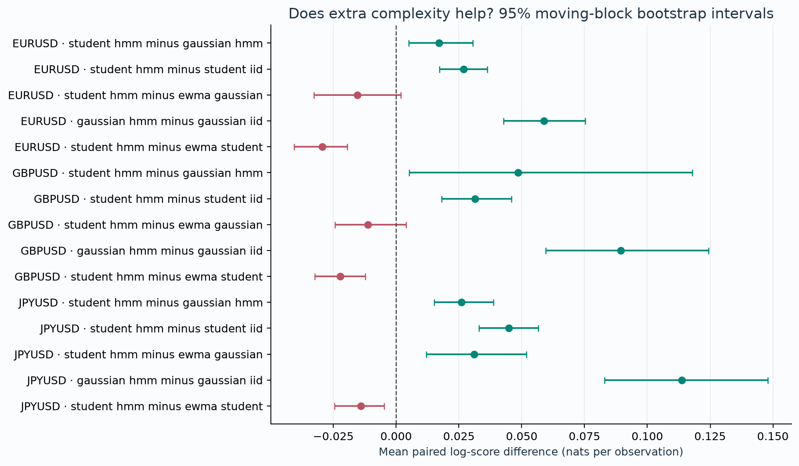
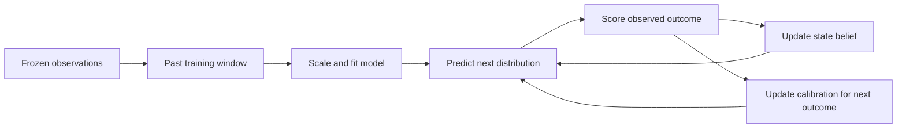

# Do Hidden Market Regimes Improve Tail-Risk Forecasts?

**Do hidden regimes improve risk forecasts—or do heavy tails and a good volatility baseline do most of the work?**

An original Python research implementation of Gaussian and Student-t hidden Markov
models, evaluated with causal walk-forward forecasts, known-state simulations,
tail calibration diagnostics, and independent numerical tests. The goal is to
measure the value of additional model complexity, including cases where it loses.

[Executed report](results/full/REPORT.md) · [Mathematical specification](docs/METHODOLOGY.md) ·
[Research protocol](docs/RESEARCH_PROTOCOL.md) · [Tutorial](notebooks/research_walkthrough.ipynb) ·
[Limitations](docs/LIMITATIONS.md) · [Interview guide](docs/INTERVIEW_GUIDE.md)



## What the executed study found

The committed run covers **400 independent synthetic datasets**, four fitted model
families per dataset, and **252 chronological fits** on Federal Reserve EUR/USD,
GBP/USD, and JPY/USD rates. Each currency contributes **5,267 held-out forecasts**
per model. The source snapshot spans 2000–2025; the first 1,250 returns train the
initial models.

| Held-out mean log density | EUR/USD | GBP/USD | JPY/USD |
|---|---:|---:|---:|
| Gaussian HMM | 3.8181 | 3.7355 | 3.7291 |
| Student-t HMM | 3.8351 | 3.7840 | 3.7551 |
| EWMA Gaussian | 3.8506 | 3.7952 | 3.7241 |
| EWMA Student-t (follow-up) | **3.8645** | **3.8064** | **3.7692** |

Higher is better. Student-t HMMs improve on Gaussian HMMs and Student-t IID
models on all three series in this experiment. Their average log-score differences
against EWMA are −0.0154, −0.0112, and +0.0311 nats per observation; the first two
paired bootstrap intervals include zero. **A complex model is not a universal
winner.** A subsequent, explicitly labeled Student-t EWMA control has higher
average log scores than the HMM on all three series, while its raw 5% breach rates
are worse (6.40%, 6.65%, 5.81%). This is a density-fit versus tail-calibration
tradeoff, not a reason to hide the simpler model. All seven models remain in the
report; [the research log](docs/RESEARCH_LOG.md) distinguishes the initial protocol
from this follow-up.

Tail calibration tells a different story from density fit. At the nominal 5%
level, raw Student-t HMM breach rates are 5.11%, 4.96%, and 4.44%; a past-only
quantile controller brings them to 4.99%, 4.88%, and 5.03%. However, correcting
average frequency does not establish independence of violations or conditional
coverage. EUR/USD and GBP/USD Student-t HMM violations remain clustered under the
reported independence diagnostic. The synthetic scale-break scenario exposes
substantial undercoverage even when the HMM has better density scores.

**248 of 252 real-data fits meet the declared convergence tolerance.** The other
four are retained with their iteration diagnostics rather than silently dropped.
These are retrospective risk-forecast results, not trading profits.

## Reproduce

Python 3.11 or newer:

```bash
python -m venv .venv
source .venv/bin/activate
pip install -e ".[dev]"
pytest -q
regime-risk run --quick
regime-risk run --output results/reproduced
```

Output directories must be empty unless `--overwrite` is explicitly supplied.

The frozen, public-domain FX snapshot is included, so the main experiment works
offline after installation. The full run takes approximately one minute on the
development machine, including 1,600 synthetic fits and forecast diagnostics;
hardware and first-time Numba compilation affect runtime. Exact runtime and
configuration are in [the manifest](results/full/manifest.json).

```bash
# Optional: retrieve a new provider snapshot into a separate directory.
regime-risk download --output data/refreshed
regime-risk run --data data/refreshed/fx_spot.csv --output results/refreshed
```

Refreshing data can change historical values. Preserve the committed snapshot
when reproducing the published tables. Do not replace it silently.

## What is implemented

- **Inference from first principles:** scaled forward recursion, backward
  smoothing, Viterbi, Gaussian EM and fixed-df Student-t EM, seeded restarts,
  variance floors, likelihood-decrease safeguards and variance-ordered states.
- **A causal forecast pipeline:** past-only standardization and rolling refits,
  posterior bridging between train/test segments, one-step predictive densities
  and mixture quantiles. Offline smoothing never enters forecast decisions.
- **A component ablation:** Gaussian/Student-t crossed with IID/HMM, plus rolling
  and EWMA volatility baselines. This distinguishes memory from heavy tails.
- **Risk diagnostics:** PIT, quantile loss, 1%/5% violations, unconditional and
  independence tests, a past-only quantile controller, and paired block-bootstrap
  uncertainty. No conditional-coverage theorem is claimed.
- **Failure studies:** contaminated emissions, structural scale changes,
  optimizer nonconvergence, and the difference between causal and smoothed regimes.



## Evidence and repository map

| File or directory | Purpose |
|---|---|
| `src/regime_risk/hmm.py` | Original inference and estimation implementation |
| `src/regime_risk/numerics.py` | Fast, stable dynamic-programming recursions |
| `src/regime_risk/walkforward.py` | Chronological training and forecast audit |
| `src/regime_risk/evaluation.py` | Quantile scores, calibration tests, block bootstrap |
| `results/full/synthetic_trials.csv` | Every simulated fit, seed and outcome |
| `results/full/forecasts.csv.gz` | Every forecast and realized outcome |
| `results/full/fit_audit.json` | Train/test boundaries, parameters and all restarts |
| `results/full/paired_logscore_intervals.csv` | Initial comparisons and labeled follow-up control |
| `tests/` | Enumeration, external oracle, causal timing and statistical checks |

See [the validation record](docs/VALIDATION.md) for the executed checks and environment.
Run `python scripts/verify_results.py results/full` to verify the frozen data, source,
artifact hashes, forecast counts and chronology.

Tests compare the HMM to exhaustive path enumeration and `hmmlearn`, not just to
another function in this repository. Future-data perturbation tests check that
earlier forecasts do not change. A separate test changes the current outcome and
checks that the already-issued forecast remains unchanged.

## Data, attribution and scope

FX data: Board of Governors of the Federal Reserve System, H.10, retrieved through
FRED ([EUR](https://fred.stlouisfed.org/series/DEXUSEU),
[GBP](https://fred.stlouisfed.org/series/DEXUSUK),
[JPY](https://fred.stlouisfed.org/series/DEXJPUS)). These series are public domain
with citation requested; see [data provenance](data/provenance.json).

The research combines a memory-versus-tail ablation, known-state failure studies,
online quantile calibration, numerical oracles, and a full forecast/optimizer audit.

See [references](docs/REFERENCES.md) for established methods. Original code is
[MIT licensed](LICENSE); third-party data retains its stated provenance. Nothing
here establishes a new HMM algorithm, a uniquely discovered market mechanism,
or a deployable trading edge.
